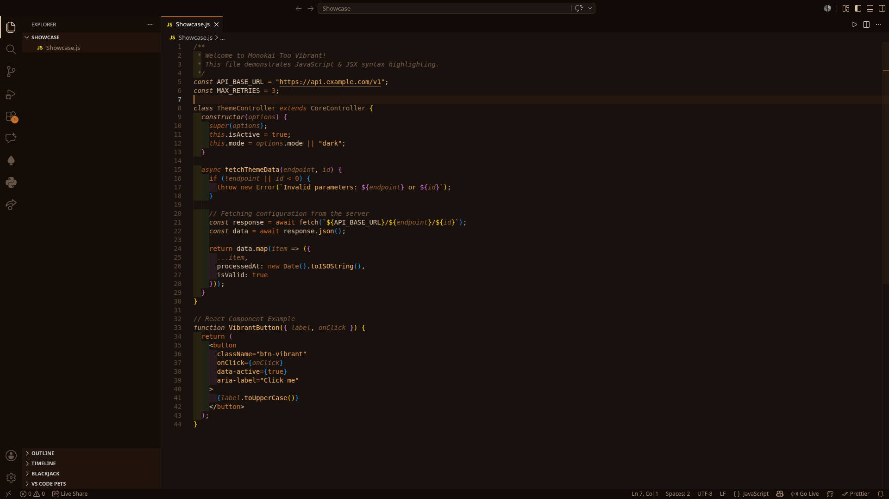
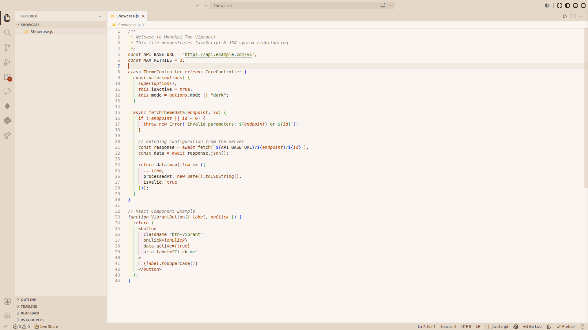

# Tung Tung Sahur Theme

A VS Code color theme inspired by the 2025 **Tung Tung Tung Sahur** meme, built around brown, wood, and sepia tones.

## Variants

- **Tung Tung Sahur Dark:** Dark brown background with burnt orange and sepia accents.
- **Tung Tung Sahur Light:** Light parchment/bamboo background with terracotta syntax colors.

## Screenshots

| Dark Mode | Light Mode |
| --- | --- |
|  |  |

## Installation

1. Open the **Extensions** view in VS Code (`Ctrl+Shift+X` or `View → Extensions`).
2. Search for `Tung Tung Sahur Wood`.
3. Click **Install**.
4. Open `Settings > Theme > Color Theme` and select **Tung Tung Sahur**.

## Background

**Tung Tung Tung Sahur** is a 2025 internet meme created by TikTok user `@noxaasht` as part of the *Italian brainrot* trend (though the character itself is Indonesian). It depicts an anthropomorphic *kentongan* (a traditional Indonesian slit drum) holding a wooden stick.

## Contributing

If you spot a contrast issue or want to tweak a syntax color, open an issue or PR on the [GitHub repo](https://github.com/TMaume/Tung-Tung-Sahur-VSTheme).

1. Fork the repo
2. Create a branch (`git checkout -b my-fix`)
3. Commit your changes (`git commit -am 'Fix something'`)
4. Push the branch (`git push origin my-fix`)
5. Open a pull request

## License

[MIT License](https://opensource.org/licenses/MIT)
